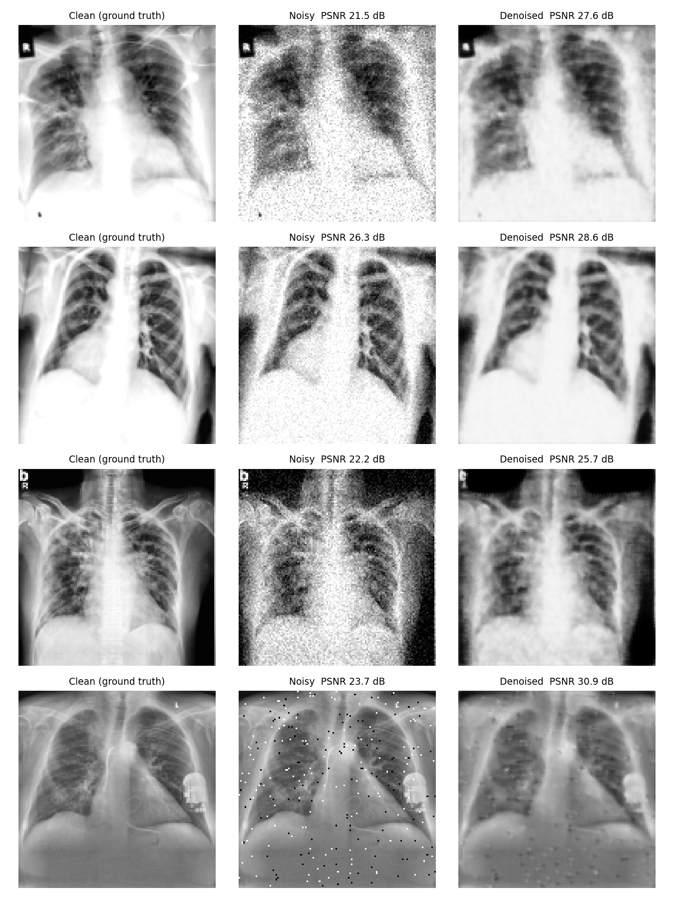
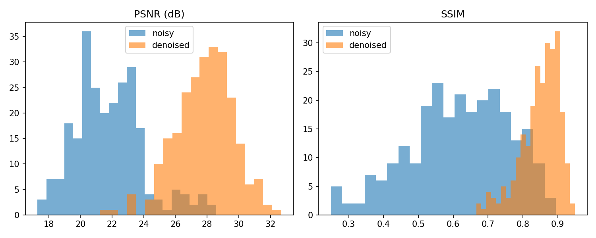
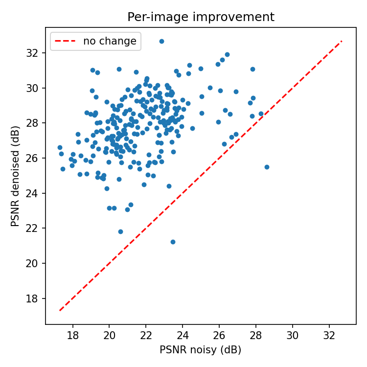

# 🫁 Medical Image Denoising System

*U-Net based denoising of lung CT scans and chest X-rays — preprocessing, training, evaluation, CLI inference and a Streamlit dashboard.*

[](https://github.com/srivastavashreyaa/Medical-Image-Denoising-UNet/actions)    

> **Disclaimer:** research / educational project, not a certified diagnostic tool.

## Overview
Noise and artifacts in medical scans can hide fine diagnostic detail. This project trains a
U-Net (convolutional encoder–decoder with skip connections) to map noisy scans to clean ones.
Skip connections preserve edges such as vessels and nodules while the network suppresses noise.

## How it works
1. **Input:** clean chest X-ray / CT images from a public dataset.
2. **Preprocess:** grayscale -> resize -> CLAHE contrast boost -> scale to [0,1] -> random flips/rotations.
3. **Make training pairs:** add synthetic noise to each clean image -> pairs of (noisy, clean).
4. **Train:** the U-Net sees the noisy image and learns to output the clean one (minimising MSE).
5. **Evaluate:** on unseen images, compare noisy vs denoised using PSNR, SSIM and MSE.
6. **Use:** denoise new images via CLI (`inference.py`) or the Streamlit app.

## Key features
- **End-to-end pipeline:** preprocessing → synthetic noise → training → evaluation → inference
- **Preprocessing:** grayscale conversion, CLAHE contrast enhancement, normalisation, augmentation (flip / rotate / brightness)
- **Noise models:** Gaussian, Poisson (quantum-style), salt-and-pepper, or mixed
- **Efficient input pipeline:** parallel, prefetched `tf.data` loader + automatic mixed precision when a GPU is present
- **Metrics:** PSNR, SSIM, MSE (per image, saved to CSV)
- **Streamlit dashboard** for interactive before/after comparison

## Model architecture
| Part | Details |
|---|---|
| Input | `256 × 256 × 1` grayscale |
| Encoder | 4 blocks, filters `32 → 64 → 128 → 256` (2×Conv+BN+ReLU, then MaxPool) |
| Bottleneck | 512 filters |
| Decoder | Transposed convs + skip connections, filters `256 → 32` |
| Output | 1×1 conv, sigmoid |
| Training | Adam (1e-3), MSE loss, ReduceLROnPlateau, EarlyStopping |

## Project structure
```
├── preprocess.py          # CLAHE, normalise, augment, noise injection -> Clean/ + Noisy/
├── model.py               # U-Net definition
├── train.py               # training, validation, metrics CSV, history plot
├── inference.py           # CLI: single image or whole folder
├── visualize.py           # metric distribution + improvement scatter plots
├── compare.py             # clean | noisy | denoised figure for random samples
├── benchmark.py           # preprocessing throughput: sequential vs tf.data
├── metrics.py             # PSNR / SSIM / MSE helpers
├── app.py                 # Streamlit dashboard
├── run_demo.py            # one-command end-to-end sanity check
├── generate_demo_data.py  # synthetic phantoms for a quick smoke test (not real data)
├── tests/                 # pytest unit tests (run in CI)
├── notebooks/train_on_colab.ipynb   # one-click GPU training on Colab
├── Dockerfile  LICENSE  .github/workflows/ci.yml
├── denoising_model.keras   # pretrained weights (+ training_info.json, denoising_metrics.csv, training_history.csv/png)
├── samples/               # 4 held-out CC BY chest X-rays for the demo
├── results/
└── requirements.txt
```

## Datasets (not included — download and cite)
- COVID-19 Radiography Database (Kaggle)
- Montgomery & Shenzhen TB chest X-ray sets
- LIDC-IDRI (lung CT)
- NIH ChestX-ray14

## Run locally in VS Code
Use **Python 3.10-3.12** (TensorFlow does not support very new Python versions).

**Windows (PowerShell):**
```powershell
python -m venv .venv
.venv\Scripts\Activate.ps1      # if blocked: Set-ExecutionPolicy -Scope Process Bypass
pip install -r requirements.txt
python run_demo.py              # ~2-5 min sanity check on synthetic images
```
**macOS / Linux:**
```bash
python3 -m venv .venv && source .venv/bin/activate
pip install -r requirements.txt && python run_demo.py
```
In VS Code press `Ctrl+Shift+P` -> *Python: Select Interpreter* -> choose `.venv`. `run_demo.py` writes
everything to `demo_output/` (synthetic data - a setup check, not reportable results).

## Installation
```bash
git clone https://github.com/srivastavashreyaa/Medical-Image-Denoising-UNet.git
cd Medical-Image-Denoising-UNet
pip install -r requirements.txt
```

## Usage
**0. (Optional) smoke test without a dataset**
```bash
python generate_demo_data.py --count 60 --output_dir raw_images
```
**1. Build the paired dataset**
```bash
python preprocess.py --input_dir ./raw_images --output_dir ./data --img_size 256 --augment 2 --noise_type mixed
```
**2. Train**
```bash
python train.py --data_dir ./data --epochs 30 --batch_size 8
```
Outputs `denoising_model.keras`, `training_history.png`, `denoising_metrics.csv` and prints mean PSNR / SSIM / MSE reduction on the held-out split.

**3. Inference**
```bash
python inference.py --input noisy.png --output denoised.png --model denoising_model.keras --compare
python inference.py --input_dir ./noisy_images --output_dir ./denoised_results --compare
```
**4. Plots & dashboard**
```bash
python visualize.py --metrics denoising_metrics.csv --output_dir ./results
streamlit run app.py
```
**5. Qualitative before/after figure**
```bash
python compare.py --data_dir ./data --n 4   # -> results/qualitative_comparison.png
```
**6. Benchmark the input pipeline**
```bash
python benchmark.py --data_dir ./data
```

## Train on a free GPU
Open `notebooks/train_on_colab.ipynb` in Google Colab (T4 GPU) - it downloads the dataset, preprocesses, trains, evaluates and exports all results.

## Docker / tests
```bash
docker build -t denoise-app . && docker run -p 8501:8501 denoise-app   # needs denoising_model.keras in the repo
pip install pytest && pytest -q
```

## Results
Pretrained model included (`denoising_model.keras`): U-Net, **128×128** input, trained for
**5 epochs** (best checkpoint kept) on **1,420** noisy/clean pairs from a public chest X-ray / CT
collection (COVID-19 chest X-ray/CT image collection (ieee8023): frontal X-ray + CT slices). Evaluated on **250** held-out pairs (125 unseen scans, split by source image
so augmented copies never leak into validation). Noise is synthetic (Gaussian / Poisson / salt-and-pepper mix).

| Metric | Noisy | Denoised | Change |
|---|:---:|:---:|:---:|
| PSNR (dB) | 21.80 | 27.86 | **+6.06** |
| SSIM | 0.617 | 0.850 | **+0.233** |
| MSE reduction | - | - | **75.7%** |

PSNR improved on 99.2% of held-out images, SSIM on 97.2%.


| Metric distributions | Per-image gain |
|---|---|
|  |  |

**Limitations (be upfront about these):** trained on *synthetic* noise, so real scanner noise may behave differently;
only 5 epochs at 128 px on CPU (a GPU run at 256 px for 30+ epochs will be sharper); some faint
salt-and-pepper speckle can remain; dataset is mostly COVID-era frontal X-rays plus a few CT slices.
Not for diagnosis.

## Live demo (Streamlit Community Cloud)
1. Push this folder to GitHub (the model file is ~23 MB, fine for GitHub).
2. Go to share.streamlit.io -> *New app* -> pick the repo, branch `main`, main file `app.py`.
3. In *Advanced settings* choose **Python 3.11**, then deploy. Put the resulting link in your README and resume.

## Data & attribution
Training images: COVID-19 image data collection, J. P. Cohen et al., https://github.com/ieee8023/covid-chestxray-dataset
(arXiv:2003.11597). Images carry individual licenses (many are non-commercial); images are **not** redistributed here
except 4 CC BY 3.0 samples in `samples/` (see `samples/ATTRIBUTION.md`). Use for research / education only.

## Roadmap
- Real noise from low-dose CT (not only synthetic noise)
- Compare against DnCNN / Noise2Noise / diffusion baselines
- Add perceptual or SSIM-based loss
- Dockerfile and hosted demo
